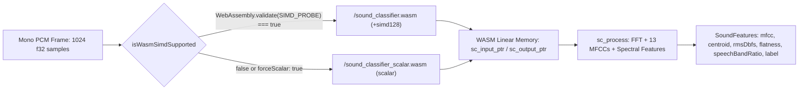

# Rust WebAssembly SIMD Acoustic Sound Classifier

## 1. Overview & Architecture

WorkSphere ships a zero-dependency Rust WebAssembly acoustic classifier (`src/wasm/acoustic/sound_classifier.rs`) paired with a TypeScript client loader (`src/core/audio/WasmSoundClassifier.ts`) for on-device, privacy-preserving noise analysis.

- **Zero External Network or Host Imports**: The Rust crate (`crate-type = ["cdylib", "rlib"]`) declares no external Cargo dependencies and imports zero host functions, guaranteeing audio samples never leave linear memory.
- **Frame & Feature Pipeline**: Processes 1024-sample mono PCM frames (`SOUND_FRAME_LENGTH = 1024`) at sample rates between `4,000 Hz` and `192,000 Hz` (default `44,100 Hz`), extracting 13 Mel-Frequency Cepstral Coefficients (`MFCC_COUNT = 13`), spectral centroid (`Hz`), RMS level (`dBFS`), spectral flatness (`0..1`), and speech-band energy ratio (`300–3,400 Hz`), classifying frames into `silence`, `chatter`, `grinder`, or `other`.
- **Dual-Binary Distribution**: Two precompiled WebAssembly artifacts are emitted into `public/`:
  - `public/sound_classifier.wasm`: Compiled with 128-bit WebAssembly SIMD (`+simd128` via `f32x4` vector kernels).
  - `public/sound_classifier_scalar.wasm`: Compiled with `RUSTFLAGS=""` (scalar fallback) for engines lacking WebAssembly 128-bit SIMD support.

